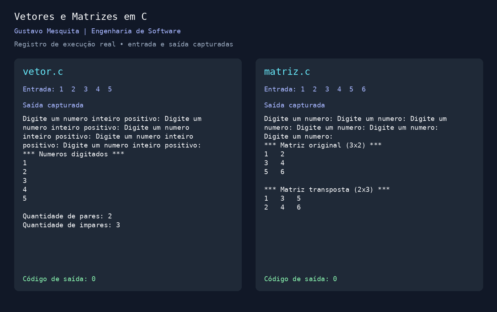

# Vetores e Matrizes em C

Projeto acadêmico de Gustavo Mesquita, estudante de Engenharia de Software, desenvolvido no segundo semestre de 2026. Reúne dois exercícios de armazenamento e processamento de dados com vetores, matrizes e estruturas de repetição.

## Programas

| Programa | Objetivo |
| --- | --- |
| `src/vetor.c` | Receber cinco inteiros positivos, exibi-los e contar pares e ímpares |
| `src/matriz.c` | Ler seis inteiros em uma matriz 3 × 2 e exibir a matriz original e sua transposta 2 × 3 |

## Tecnologias e conceitos

Linguagem C, biblioteca padrão stdio.h, arrays, for, do-while, if/else, operador de resto e entrada e saída no terminal. Cada arquivo possui seu próprio main e deve ser compilado separadamente.

## Executar

Requer um compilador C, como GCC. No Windows, os comandos abaixo pressupõem GCC disponível no PATH.

Baixe e extraia o projeto ou clone com Git usando os comandos abaixo.

```bash
git clone https://github.com/Gustass-dark/vetores-e-matrizes-em-c.git
cd vetores-e-matrizes-em-c
mkdir build
gcc -std=c11 -Wall -Wextra -Wpedantic src/vetor.c -o build/vetor
gcc -std=c11 -Wall -Wextra -Wpedantic src/matriz.c -o build/matriz
```

No Linux ou macOS, execute `./build/vetor` e `./build/matriz`. No PowerShell do Windows, execute `.\build\vetor.exe` e `.\build\matriz.exe`. Digite cada número e pressione Enter.

## Demonstrações



Imagem montada a partir das entradas e saídas reais capturadas durante a execução.

No vetor, a entrada 1, 2, 3, 4, 5 produz dois pares e três ímpares.

Na matriz, a entrada 1, 2, 3, 4, 5, 6 produz os seguintes resultados.

```text
Matriz original (3x2)
1  2
3  4
5  6

Matriz transposta (2x3)
1  3  5
2  4  6
```

As entradas e saídas completas de execuções reais estão em [exemplo do vetor](docs/exemplo-vetor.txt) e [exemplo da matriz](docs/exemplo-matriz.txt).

## Validação

Os dois programas foram compilados com GCC em modo C11 com Wall, Wextra e Wpedantic, sem avisos. Seis casos foram executados, cobrindo contagem de pares e ímpares, repetição ao receber zero e negativos no vetor, matriz com valores negativos e zero, transposição e entrada textual inválida em ambos.

O vetor repete a leitura quando recebe um inteiro menor ou igual a zero. Os programas encerram com código 1 quando scanf não consegue converter a entrada para inteiro. A leitura usa scanf com %d, que não valida uma linha completa nem protege contra números fora do intervalo de int. Entradas com prefixo numérico podem ser parcialmente aceitas. O exemplo da matriz aceita zero e negativos.

## Autoria

Código desenvolvido por Gustavo Mesquita. A preparação para o portfólio organizou os arquivos e sua indentação, acrescentou documentação e .gitignore e conferiu execuções.

## Licença

O código está sob a [licença MIT](LICENSE).
